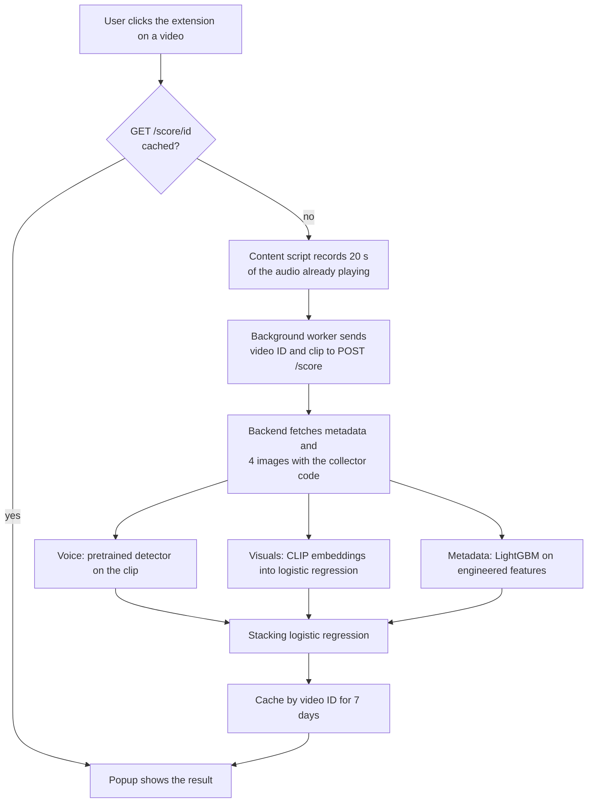

# AI Slop Detector

A Chrome extension for YouTube. Click it while watching a video and it gives a probability that the video is AI generated, plus three sub-scores that act as the reasons.

```
87% likely AI
Voice      94%
Visuals    71%
Metadata   40%
```

It scores the current video only, not the channel. The result is a probability, not proof.

*Demo GIF to be added once the extension has been recorded in use.*

## How a request flows



The audio comes from the browser because YouTube blocks yt-dlp from cloud IPs. The YouTube API key stays on the backend and is never in the extension.

## How the scores work

- **Voice** is a pretrained synthetic speech detector, [Gustking/wav2vec2-large-xlsr-deepfake-audio-classification](https://huggingface.co/Gustking/wav2vec2-large-xlsr-deepfake-audio-classification). The clip is cut into 5 second windows and the fake probabilities are averaged. It was picked by comparing 4 candidates in `src/eval_voice.py`.
- **Visuals** embeds the custom thumbnail and 3 auto generated frames with CLIP (ViT-B-32), averages them, and runs a logistic regression trained on `ai_visuals`.
- **Metadata** is a LightGBM model on 25 features from the title, description, tags, engagement and channel stats, trained on `label`. All of them are defined in `src/features.py`.
- **Overall** is a logistic regression over the logits of the three sub-scores, trained on out of fold scores. A second one without voice is used when audio could not be recorded.

Training and serving share the same feature code in `src/features.py`, and `src/evaluate.py` scores through the same `score_row` function the API uses.

The verdict is `likely_ai` above the unsure band, `likely_human` below it, and `unsure` inside it. The band is the F1 best threshold from cross validation, plus or minus 0.15.

## Metrics

Trained on 82 videos from 19 channels. Test set is 10 videos from 2 channels. Train and test never share a channel. From `reports/cv_metrics.json` and `reports/test_metrics.json`.

| Model | Target | CV AUC | CV AP | CV precision | CV recall | CV F1 | Test AUC | Test AP | Test precision | Test recall | Test F1 |
|---|---|---:|---:|---:|---:|---:|---:|---:|---:|---:|---:|
| Stacker, full | label | 0.694 | 0.466 | 0.595 | 0.833 | 0.694 | 1.000 | 1.000 | 0.714 | 1.000 | 0.833 |
| Stacker, no voice | label | 0.703 | 0.465 | 0.568 | 0.833 | 0.676 | 0.600 | 0.598 | 0.667 | 0.400 | 0.500 |
| Metadata | label | 0.844 | 0.691 | 0.625 | 1.000 | 0.769 | 1.000 | 1.000 | 0.833 | 1.000 | 0.909 |
| Visuals | ai_visuals | 0.644 | 0.324 | 0.322 | 0.950 | 0.481 | n/a | n/a | 0 | 0 | 0 |
| Voice | ai_voice | 0.884 | 0.701 | 0.696 | 0.762 | 0.727 | 0.960 | 0.967 | 1.000 | 0.800 | 0.889 |

**These numbers are provisional, do not read much into them yet.**

- The dataset is 92 of the planned 400 videos.
- The test set has 2 channels and no videos with AI visuals, so the test AUC of 1.000 mostly says those two channels are easy, and Visuals cannot be measured at all.
- The metadata model leans on channel size. `subs_per_video` alone reaches 0.932 AUC on train because the real videos are mostly from large creators and the AI ones from small channels. Expect small real creators to be over flagged until the data has real videos from small channels and AI videos from large ones.

## Run locally

Needs Python 3.12 or newer, ffmpeg on the PATH, and a YouTube Data API key.

```powershell
python -m venv .venv
.venv\Scripts\activate
pip install torch torchvision --index-url https://download.pytorch.org/whl/cu132
pip install -r requirements.txt
"YOUTUBE_API_KEY=your-key" | Out-File -Encoding ascii .env

uvicorn api:app --app-dir src --port 8000
```

Then load the extension: open `chrome://extensions`, turn on Developer mode, click **Load unpacked** and pick the `extension` folder. `extension/config.js` points at `http://localhost:8000` by default.

Run the tests with `pytest`.

With Docker:

```powershell
docker build -t ai-slop-detector .
docker run --env-file .env -p 8000:8000 ai-slop-detector
```

## Add data

```powershell
python src/collect.py "<youtube link>" <ai_voice 0|1> <ai_visuals 0|1> <ai_thumbnail 0|1>
python src/collect.py stats
```

`ai_visuals` is about the video itself, `ai_thumbnail` about the thumbnail only. Each new row gets its train or test split straight away from a hash of its channel ID, so adding data never moves existing videos. Keep to 5 videos per channel. Adding a video that is already in the database updates its labels.

## Retrain

```powershell
python src/features.py     # only computes videos missing from the caches
python src/eval_voice.py   # optional, compares the voice detectors again
python src/train.py        # writes models/ and reports/cv_metrics.json
python src/evaluate.py     # scores the test split, reports/test_metrics.json
```

Only `evaluate.py` reads the test split. Do not tune anything based on its output. A retrain gets a new model version, which invalidates the score cache.
